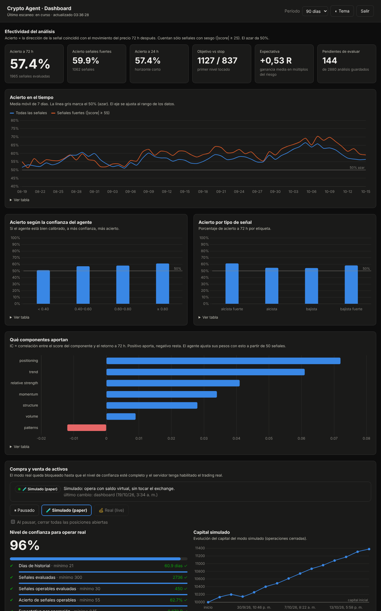

# 🤖 Crypto Agent — agente de análisis continuo del mercado cripto

Agente autónomo que corre 24/7 en tu VPS y analiza todo el mercado cripto:

- **Análisis técnico multi-timeframe** (1d, 4h, 1h, 15m): EMAs, ADX, Supertrend, Bollinger/Keltner (squeeze), ATR.
- **Momentum**: RSI, MACD, StochRSI, ROC normalizado por volatilidad, MFI y **divergencias** regulares y ocultas.
- **Patrones de velas**: 61 detectores de TA-Lib con **filtro de contexto** (tendencia previa, soporte/resistencia, volumen, confirmación).
- **Estructura de mercado**: pivots, soportes/resistencias, BOS/CHoCH y Fair Value Gaps.
- **Estudio de mercado continuo**: universo dinámico (top 40 por volumen), fuerza relativa vs BTC, amplitud, régimen (HMM), macro (Fear & Greed, dominancia, stablecoins).
- **🆕 LPF — Leverage & Positioning Flow**: análisis del posicionamiento en derivados (cuadrante precio/OI, funding z-score, CVD spot vs perpetuo, top traders vs retail, riesgo de squeeze, mapa estimado de liquidaciones) y **momentum ajustado por apalancamiento**. Ver [docs/ANALISIS_LPF.md](docs/ANALISIS_LPF.md).
- **Auto-evaluación**: mide el acierto de sus propias señales a 72h y **recalibra los pesos** de cada componente según el IC observado.
- **Salidas**: alertas e informe diario por **Telegram** (con narrativa de Claude), **dashboard web de efectividad**, API HTTP y base de datos con el historial.
- **Compra/venta en pausa**: modos pausado → simulado → real, con el modo real bloqueado hasta demostrar ventaja con datos.

> ⚠️ Es una herramienta de análisis, no de asesoramiento financiero. Validá el desempeño con `/performance` antes de operar con sus señales.

## Documentación

| Documento | Contenido |
|---|---|
| [docs/DESPLIEGUE.md](docs/DESPLIEGUE.md) | **Paso a paso para subirlo a tu VPS** con Coolify, verificación y problemas frecuentes |
| [docs/TRADING.md](docs/TRADING.md) | Módulo de compra/venta: modos, reglas de riesgo, nivel de confianza y cómo activar el modo real |
| [docs/REPOSITORIOS.md](docs/REPOSITORIOS.md) | Investigación de repos de GitHub: qué se usa completo, qué parcial y qué se descartó |
| [docs/ARQUITECTURA.md](docs/ARQUITECTURA.md) | Módulos, flujo de datos, base de datos, API y presupuesto de recursos del VPS |
| [docs/METODOLOGIA.md](docs/METODOLOGIA.md) | Fórmulas y reglas de cada componente, scoring, plan operativo y auto-evaluación |
| [docs/ANALISIS_LPF.md](docs/ANALISIS_LPF.md) | El análisis nuevo: fundamentos, cálculo, validación y limitaciones |

## Ejemplo de alerta (valores ilustrativos)

```
🟢🟢 ETH/USDT — ALCISTA FUERTE
Score +70/100 · confianza 0.86 · precio 3,412
Plan (4h, long): entrada 3,385–3,412 | stop 3,301 | objetivos 3,580 / 3,700 | R:R 1.5
LPF +0.33 · funding 11.0% anual · OI +6.2% · calidad momentum x1.30
Claves:
• [1d] BOS alcista
• [1d] vela envolvente alcista (en soporte, confirmado)
• [LPF] cuadrante precio/OI: nuevos largos
• [LPF] flujo liderado por spot (suba sana)
⚠️ Análisis automatizado con fines informativos. No es asesoramiento financiero.
```

## Prueba local

```bash
cd crypto-agent
python3.12 -m venv .venv && source .venv/bin/activate
pip install -r requirements-dev.txt
pytest                                                   # 37 tests, sin red
PYTHONPATH=src python -m cryptoagent scan -s BTC/USDT ETH/USDT SOL/USDT
PYTHONPATH=src python -m cryptoagent backtest -s BTC/USDT -t 4h -d 730
API_TOKEN=dev PYTHONPATH=src python -m cryptoagent serve --port 8080   # dashboard en http://localhost:8080
```

## Despliegue en el VPS

👉 **Guía paso a paso: [docs/DESPLIEGUE.md](docs/DESPLIEGUE.md)** (Coolify en Hostinger, 30–45 min).

Resumen: en Coolify, **+ New → Public Repository** → `https://github.com/apinett/Asistente-ia` · Build Pack
**Docker Compose** · Base Directory **`/crypto-agent`** → cargá `API_TOKEN` y Telegram → **Deploy** → verificá con
`python -m cryptoagent doctor` desde la terminal del contenedor.

## Dashboard de efectividad

`https://tu-dominio/dashboard` (pide el `API_TOKEN`; se guarda sólo en tu navegador).



*Captura con datos de ejemplo.* Muestra:
- **% de acierto** de las señales a 72 h (y a 24 h), total y de señales fuertes, contra la línea del 50% (azar).
- **Evolución del acierto** (media móvil de 7 días).
- **Calibración**: acierto según la confianza que el agente le dio a cada análisis.
- Acierto por tipo de señal, objetivo vs stop y **expectativa en R**.
- **Qué componentes aportan** (IC de tendencia, momentum, LPF, etc.) y cómo se ajustaron sus pesos.
- Panel de **trading**: modo, nivel de confianza, capital simulado/real, posiciones y operaciones.

Chart.js se sirve desde el propio agente: no depende de CDNs externos.

## Compra y venta (en pausa)

El módulo de trading **arranca pausado**. Desde el dashboard podés pasar a **simulado** (saldo virtual) para
medir la operatoria. El modo **real** se habilita sólo cuando el *nivel de confianza* llega al 100% y además
cargaste API keys de Binance (sin permiso de retiro) con `TRADING_LIVE_ENABLED=true`.
Detalle completo: [docs/TRADING.md](docs/TRADING.md).

### Uso de la API
```bash
TOKEN=...; URL=https://agente.tudominio.com
curl -H "Authorization: Bearer $TOKEN" $URL/market                 # ranking del mercado
curl -H "Authorization: Bearer $TOKEN" $URL/symbol/BTC             # análisis completo de BTC
curl -H "Authorization: Bearer $TOKEN" $URL/stats/effectiveness    # efectividad (lo que muestra el dashboard)
curl -H "Authorization: Bearer $TOKEN" $URL/trading/status         # modo, nivel de confianza, cuentas
curl -X POST -H "Authorization: Bearer $TOKEN" $URL/report         # informe diario ahora
```

## Configuración

Todo se ajusta en [`config/settings.yaml`](config/settings.yaml): tamaño del universo, temporalidades y sus pesos,
pesos de cada componente, umbrales de señal y de alerta, cooldown y horarios. Los secretos van **sólo** en variables de entorno.

## Recomendaciones operativas

- Activá en Hostinger los **backups automáticos** del VPS, o copiá `/app/storage/backups` fuera del servidor.
  Hoy el plan hace backup semanal.
- Dejá correr el agente **3 o 4 semanas** antes de confiar en sus señales y revisá `/performance`: el IC por
  componente te dice qué funciona en el mercado actual.
- Usá el plan (stop/objetivos) como referencia de riesgo, no como orden automática.
